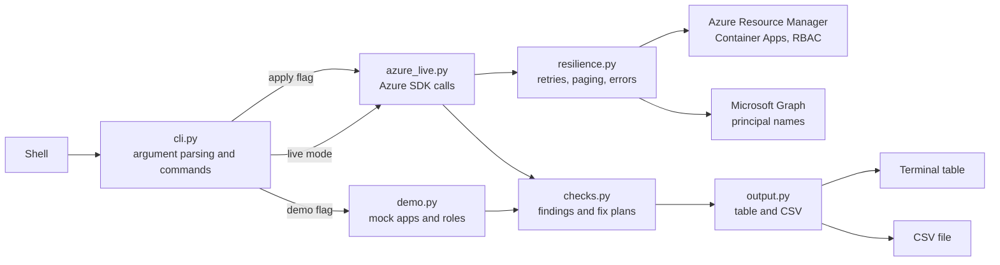

# acasentry

CLI-only access and identity review for Azure Container Apps: who holds which roles, which apps are reachable from the internet, which secrets are not in Key Vault, and which apps lack a managed identity.

[](https://github.com/chriswayneh/acasentry/actions/workflows/ci.yml)
[](LICENSE)
[](pyproject.toml)
[](https://github.com/chriswayneh/acasentry/releases/tag/v0.2.1)

Two fix commands (`identity`, `lockdown`) print dry-run plans unless `--apply` is given.

## Quick start

```
git clone https://github.com/chriswayneh/acasentry.git
cd acasentry
pip install -e .
acasentry exposure --demo
```

Requires Python 3.10 or newer. `--demo` uses built-in mock data, so no Azure account is needed. Check the installed version with `acasentry --version`.

## Usage

### Commands

| Command | What it does |
|---|---|
| `rbac` | Role assignments on each environment and app. Flags Owner, Contributor and guest (#EXT#) users. |
| `exposure` | Apps with external ingress. REACHABILITY is `public` or `vnet-only` (internal VNet environment or public network access disabled). Public apps are flagged NO_IP_RULES, NO_AUTH, AUTH_NOT_ENFORCED (auth enabled but anonymous allowed, or no unauthenticated action set, which is treated conservatively) and AUTH_EXCLUDED_PATHS. |
| `secrets` | INLINE_SECRET: a Container Apps secret not backed by a Key Vault reference (encrypted at rest by Container Apps, but not centrally managed or rotated). PLAINTEXT_ENV: an env var in a container or init container with a literal value and a secret-looking name. VALUE column: env rows show `********` and secret rows show `-`; values are never read and there is no flag to reveal them. |
| `identity [--resource-group RG] [--apply]` | Enables system-assigned managed identity where missing. |
| `lockdown <app or resource ID> [--resource-group RG] [--allow-ip CIDR] [--apply]` | Switches ingress to internal, or adds IP allow rules when `--allow-ip` is given. If the name matches apps in several resource groups it refuses and lists the candidate IDs. Apps with ingress disabled are a no-op. |

### Demo mode

```
acasentry rbac --demo
acasentry exposure --demo
acasentry secrets --demo
acasentry identity --demo
acasentry lockdown orders-api --demo
acasentry lockdown orders-api --demo --allow-ip 203.0.113.0/24
```

Every command accepts `--demo`, `--csv out.csv`, and `--subscription <id>` (required in live mode). `identity` and `lockdown` accept `--apply`; with `--demo`, `--apply` is simulated and never touches Azure.

### Live mode

```
az login
acasentry exposure --subscription <subscription-guid>
```

- Auth uses `DefaultAzureCredential`, so `az login`, service principal environment variables (`AZURE_CLIENT_ID`, `AZURE_TENANT_ID`, `AZURE_CLIENT_SECRET`) and managed identity all work.
- The identity needs Reader on the subscription for the report commands and Contributor on the target apps for `--apply`.
- Every Azure or network error prints a one-line `error:` message with a hint (not signed in, invalid or unknown subscription ID, permission denied, 400, 404, 409, other HTTP errors, connection failures) and exits with code 2, without a traceback. Only the first line of the Azure message is shown.
- `rbac` resolves principal object IDs to UPNs or display names through Microsoft Graph (needs User.Read.All or Directory.Read.All). Guests are detected by `#EXT#` in the UPN or `userType` Guest. If Graph is denied, object IDs are shown with a warning and guest detection may be incomplete.
- Every list call is read to the last page.
- Throttling (429) and transient errors (408, 5xx, connection errors) are retried up to 5 attempts with exponential backoff capped at 30 seconds per wait; `Retry-After` is honored within that cap. The Azure SDK pipeline retry is turned off so the two do not stack.
- With `--apply`, the plan is printed first, then each resource is changed and reported as `OK` or `FAILED`. If any fail, a PARTIAL summary is printed and the exit code is 1.
- CSV cells starting with `=`, `+`, `-`, `@`, tab or CR are prefixed with `'` so spreadsheets do not run them as formulas (the `-` placeholder cell is left as is).
- `lockdown --allow-ip` keeps existing Allow rules and appends new CIDRs (duplicates skipped). Apps with Deny rules are refused, since Azure does not allow mixing Allow and Deny.
- `--allow-ip` must be a valid CIDR; `0.0.0.0/0` and `::/0` are refused, and very broad ranges (IPv4 /1 to /8, IPv6 /1 to /32) print a warning.

### Sample output

Real output from running each demo command:

```
$ acasentry rbac --demo
SCOPE           PRINCIPAL                                     TYPE              ROLE                 FLAGS
--------------  --------------------------------------------  ----------------  -------------------  -----------------
cae-prod        alice@contoso.com                             User              Owner                OWNER
cae-prod        ops-team                                      Group             Reader               ok
orders-api      bob_partner.com#EXT#@contoso.onmicrosoft.com  User              Contributor          CONTRIBUTOR,GUEST
orders-api      ci-deployer                                   ServicePrincipal  Contributor          CONTRIBUTOR
web-frontend    carol@contoso.com                             User              Reader               ok
billing-worker  dave@contoso.com                              User              ContainerApp Reader  ok

6 row(s).
$ acasentry exposure --demo
APP           REACHABILITY  IP_RULES  AUTH      FLAGS
------------  ------------  --------  --------  -------------------
orders-api    public        0         off       NO_IP_RULES,NO_AUTH
web-frontend  public        1         required  ok

2 row(s).
$ acasentry secrets --demo
APP             KIND    CONTAINER  NAME           VALUE     FLAG
--------------  ------  ---------  -------------  --------  -------------
orders-api      secret  -          db-password    -         INLINE_SECRET
orders-api      env     app        API_TOKEN      ********  PLAINTEXT_ENV
billing-worker  secret  -          smtp-pass      -         INLINE_SECRET
billing-worker  env     app        SMTP_PASSWORD  ********  PLAINTEXT_ENV

4 row(s).
$ acasentry identity --demo
APP             RESOURCE_GROUP  CURRENT       PLANNED
--------------  --------------  ------------  ---------------------------
orders-api      rg-demo         None          SystemAssigned
billing-worker  rg-demo         UserAssigned  SystemAssigned,UserAssigned

2 row(s). DRY RUN: no changes made. Re-run with --apply to execute.
$ acasentry lockdown orders-api --demo
APP         RESOURCE_GROUP  SETTING   CURRENT  PLANNED
----------  --------------  --------  -------  -------
orders-api  rg-demo         external  True     False

1 row(s). DRY RUN: no changes made. Re-run with --apply to execute.
```

## Architecture

`cli.py` parses the command and loads apps and role assignments from either `demo.py` or `azure_live.py`. `checks.py` turns that data into findings and fix plans, and `output.py` prints a table and optionally writes CSV. With `--apply`, `cli.py` sends each planned change back through `azure_live.py`. Built on `azure-identity`, `azure-mgmt-appcontainers` and `azure-mgmt-authorization`. Live mode uses `DefaultAzureCredential` (az login, environment variables, or managed identity).



## Roadmap

Planned phases through `v1.0.0` are in [ROADMAP.md](ROADMAP.md). Release history is in [CHANGELOG.md](CHANGELOG.md).

## Development

```
pip install -e ".[dev]"
pytest
```

See [CHANGELOG.md](CHANGELOG.md) for release notes and [SECURITY.md](SECURITY.md) to report a vulnerability.

## License

MIT. See [LICENSE](LICENSE).
